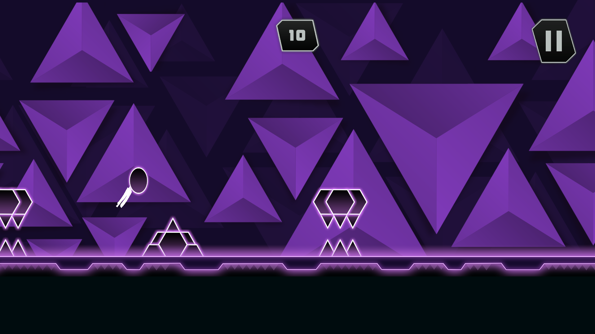
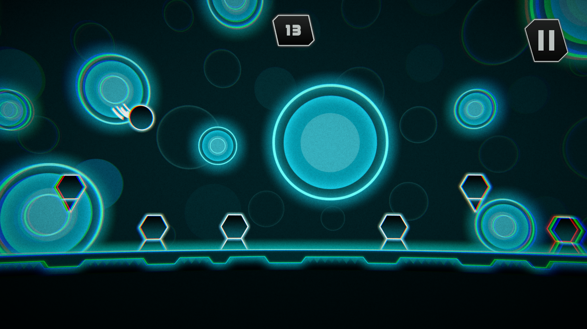
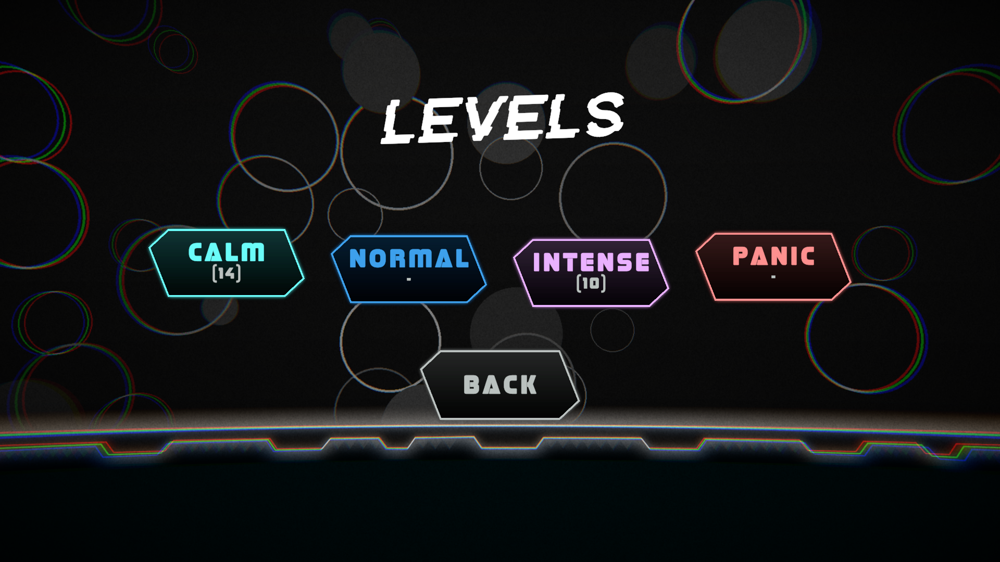

# TemporalLit
Unity 2D game, infinite runner. It's a Geometry Dash with an infinite runner mechanic.

# Instructions
Extract .zip and double click .exe

# Images
<table>
	
  <tr>
  	<td></td>
    <td></td>
    <td></td>
  </tr>
</table>
